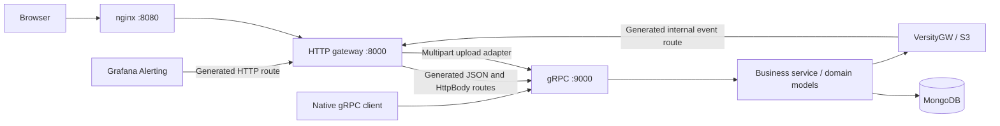

# Cloud Storage

Облачное файловое хранилище на Go с **gRPC API** и **grpc-gateway** для HTTP/JSON.
Файлы хранятся в S3-совместимом VersityGW, пользователи, метаданные и оповещения —
в MongoDB. gRPC-сервер и HTTP gateway работают в одном backend-процессе.

## Архитектура



## Запуск

```bash
cp .env.example .env
# Set your own credentials and secrets in .env.
docker compose up -d --build
```

| Компонент | Адрес на Docker-хосте |
|---|---|
| Веб-интерфейс и HTTP API | http://localhost:8080 |
| Swagger UI | http://localhost:8080/swagger/ |
| Спецификация HTTP API | http://localhost:8080/api/openapi.yaml |
| Native gRPC | `backend:9000`, только внутри Compose-сети |
| S3 API | http://localhost:7070 |
| VersityGW WebUI | http://localhost:7071 |
| Prometheus | http://localhost:9090 |
| Grafana | http://localhost:3000 |

В WebUI VersityGW используются `S3_ACCESS_KEY` / `S3_SECRET_KEY`.
Администратор Grafana задаётся через `GRAFANA_ADMIN_USER` / `GRAFANA_ADMIN_PASSWORD`.
MongoDB и gRPC-порт не публикуются на хост автоматически. Внутренняя gRPC-связь
работает без TLS и рассчитана на доверенную сеть; для внешнего доступа нужны TLS
и отдельная настройка сети.

Для локального backend без Docker нужны доступные MongoDB и S3:

```bash
export HTTP_ADDR=:8000
export GRPC_ADDR=127.0.0.1:9000
export MONGO_URI=mongodb://localhost:27017
export S3_ENDPOINT=http://localhost:7070
# Export credentials and secrets as required.
go run ./cmd/server
```

Go-приложение читает окружение, но само не загружает `.env`. В Docker переменные
передаёт Compose. Для gRPC-клиента JWT передаётся в metadata:
`authorization: Bearer <token>`. Пример вызова с установленным `grpcurl`:

```bash
grpcurl -plaintext -import-path proto \
  -proto cloud/v1/storage.proto -d '{"credentials":{"email":"user@example.com","password":"password123"}}' \
  localhost:9000 cloud.v1.CloudStorage/Login
```

## Структура

```text
proto/cloud/v1/           protobuf-контракт
proto/google/api/         HTTP-аннотации Google с лицензиями
proto/protoc-gen-openapiv2/ OpenAPI-аннотации grpc-gateway v2.27.3
gen/go/cloud/v1/          сгенерированные Go, gRPC и gateway-файлы
api/http.yaml            HTTP-адаптеры и дополнительные схемы ответов
api/openapi.yaml          сгенерированная Swagger 2.0 спецификация
Makefile                 make generate-all запускает генерацию API
scripts/generate-api.sh   закреплённые генераторы и сборка Swagger YAML
cmd/server/               конфигурация, логгер и запуск приложения
internal/app/             сборка зависимостей и lifecycle
internal/app/grpc/        запуск и остановка gRPC-сервера
internal/app/http/        HTTP gateway, multipart-адаптер и /readyz
internal/monitoring/      фоновая проверка зависимостей и сбор метрик
internal/grpc/s3/         handlers, преобразования моделей и interceptors
internal/service/s3/      бизнес-операции и интерфейсы зависимостей
internal/domain/          доменные модели и ошибки без транспортных типов
pkg/auth/        bcrypt и JWT
internal/config/          конфигурация из окружения
internal/repo/mongo/      MongoDB: BSON-документы и преобразования моделей
internal/repo/s3/         потоковый S3-адаптер
internal/metrics/         HTTP/gRPC, S3 и прикладные метрики
scripts/                  генерация API и Swagger
web/                      frontend и nginx
configs/                  Prometheus и provisioning Grafana
```

Интерфейсы gRPC генерируются из контракта. Интерфейсы репозитория и хранилища
объявлены рядом с потребляющим их сервисом, отдельного `dependencies.go` нет.
Новые тесты при миграции не добавлялись.

## Возможности

- Регистрация и вход: email, bcrypt-хеши, JWT HS256, срок по умолчанию 24 часа.
- Загрузка с drag-and-drop и прогрессом, просмотр, скачивание, переименование и удаление.
- Поиск по подстроке имени без учёта регистра; до 1000 файлов в выдаче.
- Персональные квоты (`USER_QUOTA_BYTES`, по умолчанию 1 ГиБ) и лимит одного файла
  (`MAX_UPLOAD_BYTES`, по умолчанию 512 МиБ).
- Публичные ссылки с возможностью отзыва; интерфейс полностью на английском.
- Персональный список оповещений: предупреждение при заполнении своей квоты от 80%.

## HTTP и gRPC

Пути браузерного API сохранены. Защищённые HTTP-запросы передают
`Authorization: Bearer <token>`. Для обычных ссылок скачивания допускается
`access_token` в query string. Публичные ссылки используют собственный `share_token`.

| HTTP | RPC `cloud.v1.CloudStorage` | Назначение |
|---|---|---|
| POST `/api/auth/register` | Register | Регистрация, HTTP 201 |
| POST `/api/auth/login` | Login | Вход |
| GET `/api/me` | Me | Профиль и квота |
| GET `/api/files?q=` | ListFiles | Поиск файлов, JSON-массив |
| POST `/api/files` | UploadFile, client streaming | Multipart-адаптер, поле `file`, HTTP 201 |
| GET `/api/files/{id}/download` | DownloadFile, server streaming | Generated HttpBody; `inline=1` для просмотра |
| PATCH `/api/files/{id}` | RenameFile | JSON `{name}`, HTTP 204 |
| DELETE `/api/files/{id}` | DeleteFile | Удаление, HTTP 204 |
| POST `/api/files/{id}/share` | ShareFile | Публичная ссылка |
| DELETE `/api/files/{id}/share` | UnshareFile | Отзыв доступа, HTTP 204 |
| GET `/api/public/{token}` | PublicDownload, server streaming | Generated HttpBody без JWT |
| GET `/api/alerts` | ListAlerts | JSON-массив оповещений |
| POST `/api/alerts/webhook` | ReceiveAlerts | Generated webhook; служебный Bearer-токен |
| POST `/internal/s3-events?token=` | ReceiveStorageEvents | Generated внутренний webhook S3 |

`/healthz`, `/readyz`, `/metrics` и `/api/openapi.yaml` — служебные HTTP-обработчики.
nginx проксирует только `/api/` и `/swagger/`; `/internal/s3-events` доступен только
на backend внутри Docker-сети.

Обычные сообщения сериализуются по protobuf JSON mapping: имена полей сохранены
в `snake_case`, значения `int64` (размеры и квоты) передаются **десятичными строками**,
время — RFC 3339. Frontend учитывает это при форматировании размеров.
Ошибки HTTP сохраняют форму `{"error":"Message"}`. Коды gRPC преобразуются в HTTP:
`InvalidArgument` → 400, `Unauthenticated` → 401, `NotFound` → 404,
`AlreadyExists` → 409, `ResourceExhausted` → 413, `Internal` → 500,
`Unavailable` → 503.

### Потоковая передача файлов

При загрузке первый gRPC-пакет содержит `UploadMetadata` с именем файла, следующие —
только `data`, не более **64 КиБ** на пакет. HTTP-адаптер читает multipart-поток
и отправляет эти пакеты. gRPC-сервер передаёт reader в S3 uploader, контролирует
лимит и затем атомарно резервирует точный объём в MongoDB. При отказе резервирования
объект удаляется; при ошибке метаданных также освобождается зарезервированное место.

При скачивании gRPC metadata содержит заголовки файла, а поток ответов с вложенным `HttpBody` передаёт
байты чанками по 64 КиБ. Сгенерированный gateway выставляет `Content-Type`, `Content-Length`, `Content-Disposition`,
`nosniff` и `CSP: sandbox`, затем отдаёт байты без JSON/base64-обёртки.
S3 uploader буферизует части по 16 МиБ с параллелизмом 3; весь файл целиком не
буферизуется. Разрыв HTTP-запроса отменяет соответствующий gRPC-поток.
Общий размер файла не ограничивается лимитом одного gRPC-сообщения (4 МиБ).
Range-запросы, возобновляемая загрузка и версии файлов пока не реализованы.

## Проверки кода

```bash
make lint  # Проверка Go-кода и форматирования
make fmt   # Форматирование gofmt и goimports
make test  # Go-тесты всех пакетов
```

При первом запуске Make устанавливает golangci-lint v2.15.0 в `.bin/` внутри
проекта; нужны Go и доступ к сети.
Включены `errcheck`, `govet`, `staticcheck`, `errorlint`, `unused`, `ineffassign`,
а также проверка форматирования `gofmt` и `goimports`. Настройки находятся
в `.golangci.yml`; сгенерированный код в `gen/` исключён из замечаний.

## Генерация API и Swagger

Нужны Go 1.26+, `protoc` и Make. В Ubuntu:

```bash
sudo apt install protobuf-compiler make
make generate-all
```

Скрипт устанавливает закреплённые версии генераторов во временный каталог,
генерирует `.pb.go`, `_grpc.pb.go`, `.pb.gw.go` и Swagger YAML. Метаданные API,
авторизация, коды ответов и ограничения полей описаны OpenAPI-аннотациями в `.proto`.
Закреплённая версия `yq` объединяет результат с `api/http.yaml`: multipart-загрузкой,
выдачей спецификации и схемами массивов и бинарных ответов, которые нельзя выразить
через используемые OpenAPI v2 proto options. Результат — `api/openapi.yaml` в формате **Swagger 2.0**,
который поддерживается Swagger UI. Его не следует редактировать вручную.
Сгенерированные файлы включены в репозиторий, поэтому обычная сборка Docker
не требует инструментов генерации. Для вызовов из Swagger введите
`Bearer <token>` в **Authorize → bearerAuth**.

## Данные и синхронизация

Коллекции MongoDB: `users`, `files`, `alerts`. Байты файла лежат в бакете
`S3_BUCKET` с ключом `users/<userID>/<fileID>`. Переименование меняет только
метаданные. Тома `mongo-data` и `s3-data` сохраняются при пересоздании контейнеров;
`docker compose down -v` удалит их.

VersityGW отправляет события удаления в backend. Аннотация `.proto` связывает native
S3 payload с `ReceiveStorageEvents`; interceptor проверяет `S3_EVENT_TOKEN`.
Удаление метаданных через `FindOneAndDelete` позволяет обработать повторное событие
без штатного двойного освобождения квоты. Если событие пропущено, отсутствие объекта
обнаруживается при следующем скачивании, запись очищается, клиент получает 404.
При обычной недоступности S3 метаданные не удаляются.

Шлюз стартует после `/healthz` backend, чтобы доставить стартовое тестовое событие.
Backend создаёт бакет в фоне. Проверка `/readyz` учитывает MongoDB и S3 и может
временно отвечать 503, хотя сам HTTP-процесс уже работает.

Ограничения: постоянной очереди событий и периодической сверки нет; изменения,
сделанные во время простоя backend, не воспроизводятся. Объекты, загруженные
напрямую в S3, не импортируются в каталог. S3 и MongoDB не объединены транзакцией;
авария между операциями может потребовать восстановления согласованности квот.

## Мониторинг

Prometheus собирает `/metrics` backend и StatsD-метрики VersityGW через exporter
каждые 15 секунд. В дополнение к HTTP, S3, квотам и событиям добавлены
`cloud_grpc_requests_total{method,code}` и `cloud_grpc_request_duration_seconds`.
Для потоковых вызовов длительность охватывает всю передачу файла.

Grafana автоматически получает дашборд и 8 правил: BackendDown, ObjectStorageDown,
MongoDBDown, HighErrorRate, HighApiLatency, StorageUsageHigh, StorageOperationErrors,
LoginBruteforce. Существующие правила HTTP продолжают наблюдать HTTP gateway.
Webhook преобразуется в RPC `ReceiveAlerts`; `ALERT_WEBHOOK_TOKEN` проверяется
отдельно от JWT пользователя. При отказе MongoDB возвращается HTTP 503, чтобы
Grafana повторила доставку. Telegram/email/Slack по умолчанию не подключены.

## GitLab CI/CD и деплой по тегу

Команда `make ci` запускает локальные GitLab и Runner в Docker, создаёт приватный
проект `root/cloud` и отправляет в его ветку `main` текущий коммит. Незакоммиченные
изменения остаются локально; теги автоматически не отправляются.
Pipeline `.gitlab-ci.yml` проверяет код, собирает образы на Runner и передаёт
готовый релиз по SSH.

GitLab: <http://127.0.0.1:9080/root/cloud>. При повторном `make ci` используются
существующие проект и Runner; новые коммиты отправляются без force push.
Перед импортом изменений закоммить их. Пароль GitLab не меняется.

## Локальная Docker-сеть

`docker-compose.override.yml` задаёт подсеть `100.100.0.0/24` для окружения с VPN.
На другой машине её можно изменить или исключить override, запуская
`docker compose -f docker-compose.yml up -d --build`.
